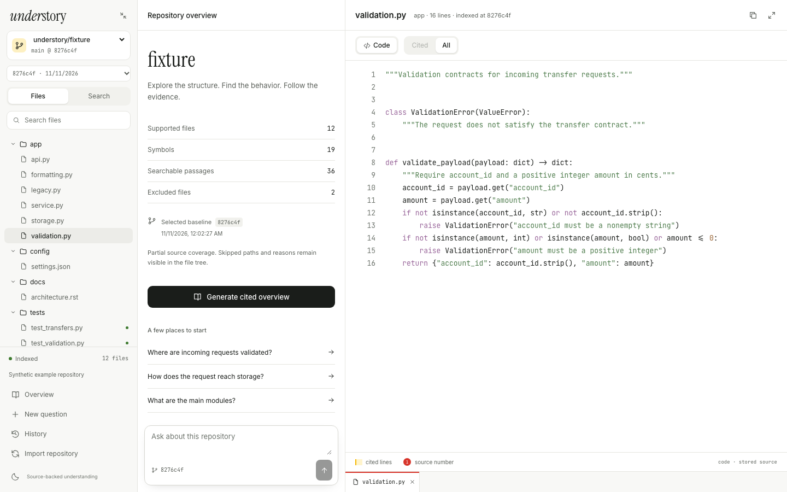

# Understory

Explore Python repositories with semantic search and source-cited answers.

Import a public GitHub repository, browse its files and symbols, and ask how the code works. Every import and answer is tied to a specific commit, so you can follow citations back to the exact source lines.



## Features

- **Search four ways** — exact, lexical, semantic, or hybrid, with filters by file type and path.
- **Follow the evidence** — cited answers and repository overviews link to source ranges.
- **Keep your context** — revisit saved questions, export answers, and browse older snapshots after a refresh.
- **Run locally** — local embeddings, optional Groq generation, and background jobs that recover after a restart.

Built with React, TypeScript, FastAPI, and PostgreSQL with pgvector.

## Quick start

Requires **Python 3.12**, **Node.js 22.12+**, **Docker Compose**, and **[uv](https://docs.astral.sh/uv/)**. Run commands from the repository root.

### 1. Install and configure

```sh
uv sync --locked --extra embeddings
npm ci --prefix frontend
cp -n .env.example .env  # preserves an existing .env
```

Generate an owner token and set it as `OWNER_TOKEN` in `.env`:

```sh
python3 -c 'import secrets; print(secrets.token_urlsafe(32))'
```

The default embedding provider downloads and runs a small model locally. Set `EMBEDDING_PROVIDER=disabled` for exact and lexical search without model downloads. Reimport repositories after changing embedding settings.

### 2. Start the database and load the demo

```sh
docker compose -p understory-local up -d database
uv run alembic upgrade head
uv run --extra embeddings understory-demo
```

The demo loads a synthetic repository so you can try the workspace before importing your own.

### 3. Start the app

Run each command in a separate terminal:

```sh
uv run --extra embeddings understory-api
uv run --extra embeddings understory-worker
npm run dev --prefix frontend
```

Open **[127.0.0.1:5173](http://127.0.0.1:5173)**, choose **Open Understory**, and enter your owner token.

To import a real repository, add its `owner/name` to `ALLOWED_REPOSITORIES` in `.env`, restart the API and worker, and use **Import repository**. Start with a small public Python project; `pallets/itsdangerous` at tag `2.2.0` is a verified example.

## Optional: AI answers

Set these values in `.env`, then restart the API and worker:

```dotenv
GENERATION_PROVIDER=groq
GENERATION_MODEL=openai/gpt-oss-120b
GROQ_API_KEY=your_key_here
DAILY_TOKEN_BUDGET=50000
```

Use a model available to your Groq account. Questions and selected source excerpts are sent to Groq; embeddings stay local and provider keys stay on the server. Search works without generation. The daily token budget is an application limit; provider quotas still apply.

## Development

With PostgreSQL running:

```sh
uv run ruff check backend migrations tests scripts
uv run pytest -q
npm run build --prefix frontend
```

Backend tests use isolated database schemas and make no Groq calls. For browser tests, start the app and seed demo snapshot A, then run:

```sh
PLAYWRIGHT_BROWSERS_PATH="$PWD/.cache/playwright" npm exec --prefix frontend -- playwright install chromium
PLAYWRIGHT_BROWSERS_PATH="$PWD/.cache/playwright" npm test --prefix frontend
```

The API runs at `http://127.0.0.1:8017` with interactive docs at `/api-docs`. Health checks are `/v1/health` and `/v1/ready`; PostgreSQL uses port `54329`.

## Documentation

- [Architecture](docs/ARCHITECTURE_DECISIONS.md) — design decisions and tradeoffs.
- [Technical specification](docs/TECHNICAL_SPEC.md) — data model, jobs, and API contracts.
- [Operations](docs/OPERATIONS.md) — recovery, model changes, retention, and backups.
- [Evaluation](evals/README.md) and [verification](docs/VERIFICATION.md) — methodology, results, and release checks.
- [Scope](docs/MVP_SCOPE.md) — supported workflows and limits.

## Scope and license

Understory is a local, single-owner MVP for small public Python repositories. It indexes Python, Markdown/RST, and selected text configs; excluded files remain visible in the inventory. Imported code is never executed. Hosted access, private repositories, and additional language parsers are outside the current scope. Citations identify the source used; review generated claims against it.

No project-wide license has been selected. See [third-party notices](THIRD_PARTY_NOTICES.md) for bundled dependencies and assets.
